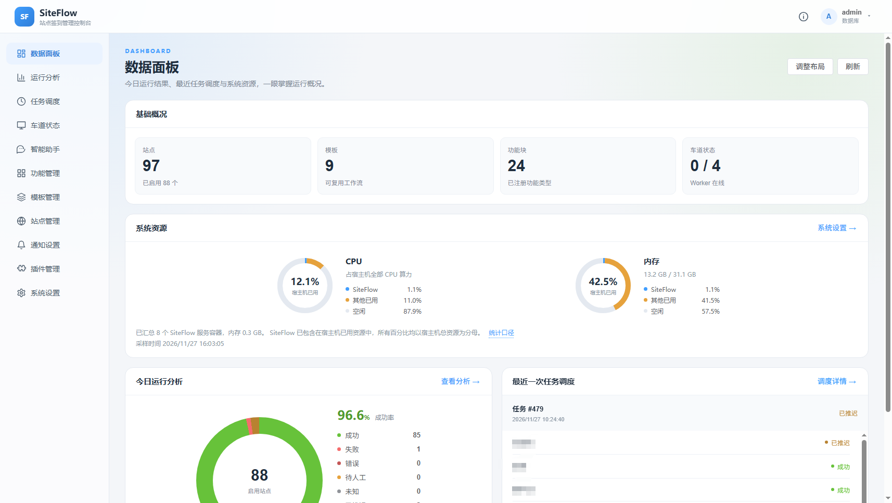
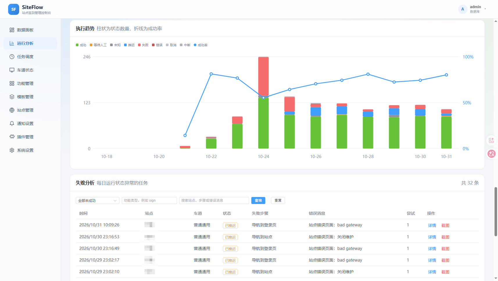
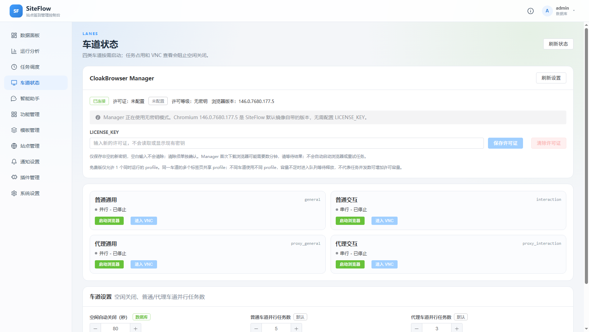
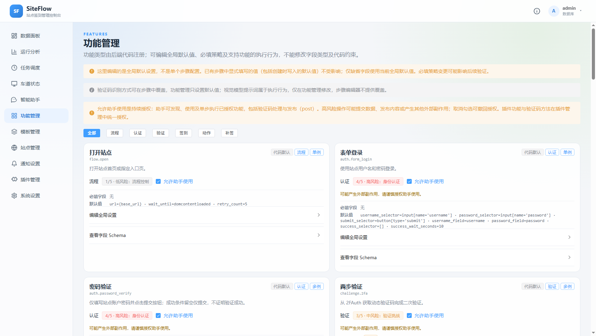
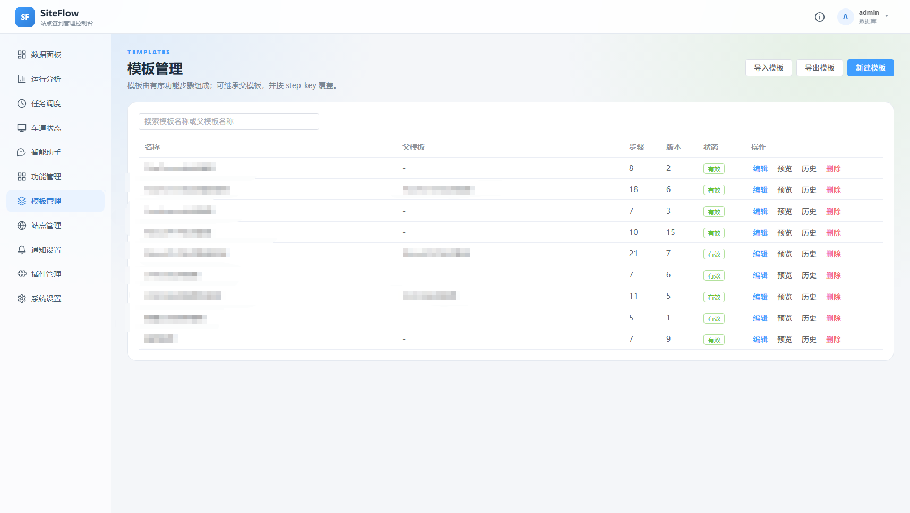
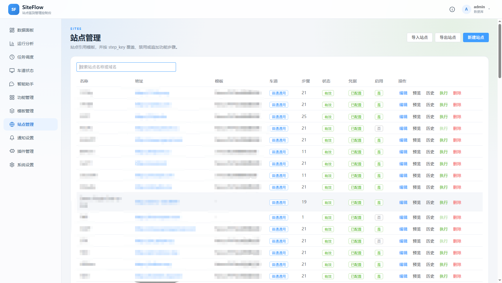
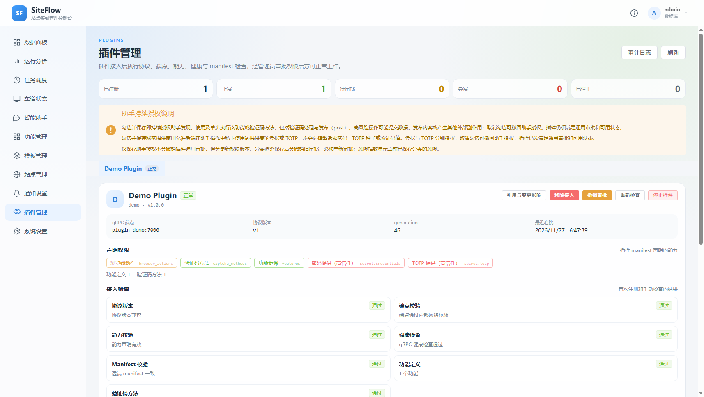
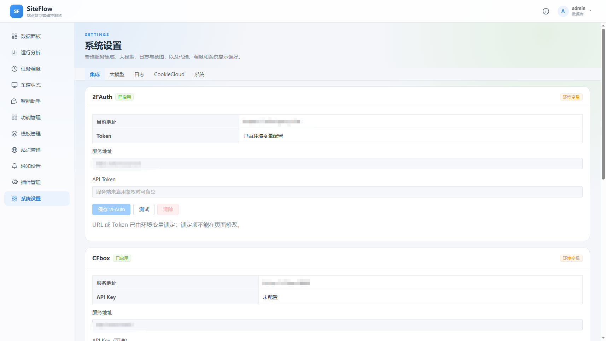
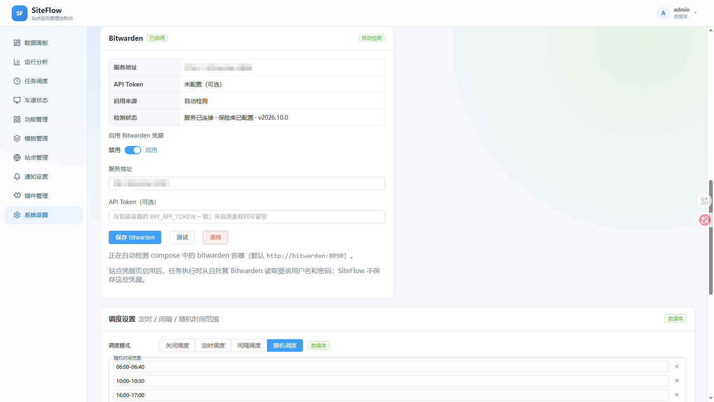

# SiteFlow

SiteFlow 是一个站点自动化管理工具，当前主要用于 **PT 站点签到**。通过可编排的工作流，将登录、验证、签到和补签串联起来，支持定时执行、浏览器人工接管和运行结果追踪。

支持的主要功能：

- **站点与工作流**：模板继承、站点覆盖、配置版本历史与恢复、条件判断、步骤跳转、配置导入导出及元素拾取；模板编辑器可从站点导入本地流程与父模板，仅填表、不自动保存。
- **登录与验证**：账户、Cookie、Bitwarden 和插件凭据；2FAuth；Turnstile、ALTCHA、图形验证码及视觉模型。
- **多模型配置**：整行「大模型」设置卡片，按优先级管理最多 20 条数据库连接（含旧配置条目），另可加 1 条环境变量连接，合计最多 21 条，也允许空列表；分别指定功能卡片/助手用途及视觉能力，无主次模型之分。已有 20 条数据库连接时，环境变量条目仍完整显示，不截断、丢弃或因此禁用列表操作；请求前选择合格模型，请求失败不自动换模型，MCP 用途仅预留。
- **签到与补签**：按钮操作、iframe 签到、UNIT3D Claim、NexusPHP 日历补签、页面循环补签（`post.resign_loop`）、弹窗按钮补签和补签卡购买。
- **自动执行**：手动运行、定时/间隔/随机调度、并发限制、取消与超时处理。
- **浏览器管理**：普通/代理、通用/交互四条车道，按需启动、空闲关闭，以及 noVNC 实时查看和人工操作。
- **智能助手**：可选启用的加密持久化对话、自动标题、脱敏查询、受限观察与真实单步验证，普通交互 38 个工具，另有 1 个接管专用结论工具；23 项内置功能可编写提案及授权完整运行，18 项支持孤立单步，购买/补签仅在完整运行中逐次消费审核，插件不开放。支持绑定站点 Cookie 私有注入与人工审核清除、审核后保存站点流程为模板、全局调度变更、精确任务取消和历史版本/日志/图像读取；独立失败接管默认关闭，可仅分析或在当前失败快照仍匹配时只修工作流，另经 live_access 明确保存授权可无人值守浏览和真实单步，绝不自动完整重跑。「仅分析」不保存配置，不代表网站无副作用。提案本身不保存、不运行，新建站点默认禁用调度，不保证生产适用或业务成功。AI 辅助配置统一使用「智能助手」，站点页不再有独立生成入口。
- **结果与通知**：步骤进度、日志、失败截图、运行分析，以及邮件和 HTTP 通知（助手调查的 HTTP 通知可附带失败截图）。
- **插件扩展**：功能、验证码方法、凭据和 2FA 提供商接入，支持能力审批、停用和审计。

详细操作见 [使用指南](docs/usage.md)。验证码识别和浏览器自动化不能保证适用于所有站点，请仅用于你有权访问的账户和服务。

## 界面预览

点击图片可查看原图。截图中的站点信息和敏感配置已做遮挡。

| 数据面板 | 运行分析 · 状态概览 |
| --- | --- |
| [](docs/screenshots/dashboard.png) | [](docs/screenshots/analytics-overview.png) |

| 运行分析 · 趋势与失败分析 | 任务调度 |
| --- | --- |
| [](docs/screenshots/analytics-trends.png) | [](docs/screenshots/runs.png) |

| 车道状态 | 功能管理 |
| --- | --- |
| [](docs/screenshots/lanes.png) | [](docs/screenshots/features.png) |

| 模板管理 | 站点管理 |
| --- | --- |
| [](docs/screenshots/templates.png) | [](docs/screenshots/sites.png) |

| 通知设置 | 插件管理 |
| --- | --- |
| [](docs/screenshots/notifications.png) | [](docs/screenshots/plugins.png) |

| 系统设置 · 模型与集成 | 系统设置 · 凭据与调度 |
| --- | --- |
| [](docs/screenshots/settings-integrations.png) | [](docs/screenshots/settings-scheduling.png) |

## 快速开始

需要 Docker 和 Docker Compose。根目录 `docker-compose.yml` 使用 GHCR 发布镜像，无需在服务器安装 Node.js 或构建工具；浏览器由 Compose 直接拉取官方 CloakBrowser Manager 镜像，以 keyless 模式运行。

```bash
git clone https://github.com/hyuan280/SiteFlow.git
cd SiteFlow
cp .env.example .env
chmod 600 .env

# 分别生成加密主密钥与浏览器后端访问令牌
openssl rand -base64 32
openssl rand -hex 32
```

将生成结果分别填入 `.env` 的 `SITEFLOW_MASTER_KEY` 和 `SITEFLOW_BROWSER_TOKEN`，不要使用示例中的 `CHANGE_ME`。按需设置各组件的镜像版本，再启动：

```bash
docker compose pull
docker compose up -d
docker compose ps
```

打开 **http://localhost:8088**。修改访问端口可在 `.env` 设置 `SITEFLOW_WEB_PORT`。

首次部署前需确保所选版本已发布；私有 GHCR 镜像需要先登录。镜像版本、数据备份及 HTTPS 部署见 [部署与运维](docs/deployment.md) 和 [镜像发布](docs/releases.md)。

可选的 [Docker Socket 系统资源监控](docs/system-resources.md) 需单独启用，主 Compose 默认不挂载 socket；启用前请阅读权限风险说明。

### 首次登录

未设置 `SITEFLOW_ADMIN_PASSWORD` 且尚未保存管理员密码时，API 每次启动会生成随机的 `admin` 密码。通过日志查看：

```bash
docker compose logs api
```

登录后通过右上角账户菜单修改密码；保存后，后续启动不再生成随机密码。

也可在 `.env` 中指定管理员账户：

```dotenv
SITEFLOW_ADMIN_USERNAME=admin
SITEFLOW_ADMIN_PASSWORD=<自行设置的强密码>
```

环境变量中的管理员凭据优先使用，且不能在页面修改。

### 配置与安全

- 代理、CFbox、2FAuth、Bitwarden、大模型等按需在「系统设置」配置；模型列表上移/下移、临时禁用或删除须显式保存，配置弹窗可一并保存列表。保存前请测试连通性，测试不代表保存配置。行内「测试」只测指定 ID 的已保存连接；弹窗「测试当前配置」可测试草稿，新条目或填写新 API Key 时由浏览器直连当前地址，不把该密钥交给 SiteFlow 后端；已有条目密钥留空则由 API 在内存中复用该条已保存密钥。浏览器失败不自动转交后端，成功也不证明 API/Worker 的生产连通性。可选 `SITEFLOW_MODEL_*` 连接设置形成一条带「环境变量」来源标签的普通条目：整条连接只读、不能打开配置弹窗或删除；UI 可保存排序和启用状态，名称/用途仅可通过 API 更新元数据，不能在 UI 编辑。其他模型不继承这些值。详见[模型设置与测试边界](docs/vision-feature-settings.md#model-registry)。
- 升级须配套更新 **API、Worker、Web**，不新增 SQL 列。模型环境变量已改名为 `SITEFLOW_MODEL_*`，**旧 `SITEFLOW_VISION_*` 名称被忽略，没有别名回退，部署方必须重命名**；上游模型名变量为 `SITEFLOW_MODEL_ID`。`SITEFLOW_MODEL_TIMEOUT=30` 是所有模型共用的请求超时（秒），单独设置不产生环境变量条目。无注册表且无旧连接/环境连接时列表为空；存在旧连接时只读合成普通条目，不迁移或改写原 `vision.*` 密文。旧 `/vision` API 仅兼容内部旧配置条目，与列表首选无关；其内部 ID `primary` 不是 UI 角色。数据库旧配置条目可删除，删除同时清理活动旧连接，避免重现；加密 `models.registry` 最多保留 512 个仅供历史日志脱敏的退役密钥，不用于运行时或返回 API，删除不承诺永久擦除。CAS 冲突保留草稿、不自动重试，刷新前核对未保存改动。
- `.env` 不提交到 Git，文件权限保持 `600`。不要公开主密钥、账户密码、Cookie、后端令牌和集成服务凭据。
- 单独备份 `SITEFLOW_MASTER_KEY`；丢失后无法恢复数据库中的加密配置。数据库与浏览器数据备份见部署文档。
- 使用 HTTPS 对外访问时设置 `SITEFLOW_COOKIE_SECURE=true`；本地 HTTP 使用 `false`。
- 只发布 Web 端口。不要公开 Worker、Manager、CDP、VNC 或共享 X11 socket。
- 初始密码可能出现在 API 日志中，需限制日志访问并及时改密。
- 各浏览器车道使用独立 profile，同车道任务使用独立标签页；更新服务前确认没有活动任务或人工浏览器会话。涉及远程后端接入的更新需同时更新 API 和 Worker。
- 使用智能助手需配套升级 Web、API 和 Worker，复用 `SITEFLOW_CONFIG_AI_ENABLED` 与大模型配置。API 注册新模型后用 `create_all()` 创建会话、消息、`assistant_workflow_actions`、`assistant_run_guards`、`assistant_job_config_snapshots` 和 `assistant_takeover_actions` 表；不是已有列迁移机制，工作流授权/标题控制字段在加密 JSON 内，不承诺迁移历史开发版表结构。新会话写入固定欢迎语、不调用模型；前 3 条用户消息内成功轮次可独立生成标题，失败仍消耗窗口，人工重命名永久锁定，旧会话默认锁定。
- 助手通过对话收集站点名称和地址，再由宿主面板确认浏览观察；执行、截图、导入/完整测试分别按需授权，也可在全局助手设置中明确开启对应默认值。凭据 `site_id` 与配置目的站点 `workflow_site_id` 独立，均须完全同源并绑定身份/修订。浏览观察使用交互/代理交互车道；保存运行车道独立，新目标默认 `general`，变更须用户确认。新导入站点默认 `enabled: false`，明确授权的助手试跑不会自动启用调度。
- 助手普通会话共 **38 个工具**，注册表另含 1 个接管专用工具，合计 **39 个**，接管会话使用受限子集。当前 **23 项内置功能**在助手及独立生成 API 中均可编写提案，目录/schema 按当前代码及服务端策略提供，包括公开非秘密 `action.fill` 和四项 `post.*`；插件、别名及未知键不开放。孤立单步 **18 项**，排除 `flow.jump` 和四项 `post.*`。后者尚未实现孤立测试，因为依赖真实 SiteJob 消费检查点，不是用户拒绝权限。`action.fill` 不能填密码、凭据、Cookie、Token 或 OTP/TOTP 认证动态码，具体字段/内容仍受宿主校验；图片 CAPTCHA 不等于 OTP。`flow.result` 单步只返回配置布尔值、不做模型判断，false 是步骤失败，不证明网站操作失败。完整工作流结果判断可按宿主策略使用模型，运行配置/提示词/提供商密钥由宿主私下传给 Worker，助手只获安全布尔结果/状态，不获原始判断答案、理由或密钥。
- 助手新浏览器首次导航前可私有注入显式有效绑定站点的已保存 Cookie，优先 `workflow_site_id`、否则凭据 `site_id`，优先绑定失效不回退、不按主机找站点；所有凭据模式均可，不增加 auth/OTP/完整运行授权，原始 Cookie 不进模型或助手会话。`clear_bound_site_cookies` 仅应用户明确要求，在原始绑定浏览器已 READY 时逐次审核清除该站点保存 Cookie 及当前共享车道精确 host/.host 的所有路径 Cookie，不清父域/其他车道、不改账号密码/localStorage、不刷新；同主机同车道标签页可能退出。无人值守接管不可清除，部分/未知结果不自动重试，也不自动打开浏览器满足清除前提。需 API、Worker、Web 配套升级；范围、generation 防旧种子回放及隐私限制见[绑定站点 Cookie](docs/ai-assistant.md#绑定站点-cookie)。
- 类别只信任代码内置 `Feature.category` 的 flow/auth/challenge/sign/action/post，不按键前缀、描述、模型参数或插件声明授权。`max_auth_uses_per_turn` 默认 **3**、严格整数 **1-20**，助手单步及完整保存运行共用发起真实用户轮次的登录/密码验证及重试额度，解析凭据前预留、失败计次；换目标/浏览器、内部模型轮次不重置。完整运行在运行时签发每次 auth 凭据租约时计一次，兑换同一租约不重复计次；条件跳过不计，循环重入及执行器重启/回退尝试申请新租约仍计次，后台运行不随新聊天轮次重置原额度。含 auth 的新 `run_site` 派发前检查剩余额度，运行中耗尽则拒绝后续 auth 租约；普通手动/调度任务不受此助手额度限制。`challenge.2fa` 属于 challenge，不占 auth 额度，OTP 始终私有。支持的 flow/challenge/sign/action 单步可在当前原始同源授权内继续，不因历史 unknown 一概拒绝；普通会话 `retry_step` 自动签发一次精确存储步骤能力，以新 UUID 执行、不弹 UI 审批，auth 重试另计额度。旧空闲/审批 API 保留人工兼容，不代表所有重试必需审批；自动接管仍拒绝 `retry_step`，新 execute_step 按类别授权检查。原 unknown 来源事实不清除，配置写入/导入及完整运行门禁不变。类别许可不是无副作用保证，物理点击、导航和脚本仍可能写网站。插件可声明六类，但元数据未验证、危险实际实现需审核，不因此开放助手。
- 导入只接受当前会话成功保存、当前目标修订且无待确认问题的 `proposal_message_id`。`update_site_config` 仅按用户要求修改受限字段及观察设置，逐次展示精确差异供确认，全局授权不能跳过；启用调度另需同会话当前配置完整成功任务。配置更新使用 CAS 并生成历史，凭据、模板和工作流集合不被设置工具重写。`run_site {}` 只经共享 executor 执行绑定的单个已保存站点，无任意 ID/全部/force。全部 23 项内置功能可用于完整运行，插件功能/方法/提供商仍拒绝，包括继承项；可信观察来源不授予完整运行或凭据权限。配置守卫核对本地/解析配置、祖先模板和功能策略；无消费计划时正常同代理模式通用到交互回退仍允许。
- 助手完整运行中的 `post.buy_card`、`post.resign`、`post.resign_loop`、`post.resign_dialog` 每次实际新派发都须 owner **逐 post 步骤**审核冻结消费计划，每个步骤全新面板、全部批准后才启动一次保存的完整工作流，不为每个日期或内部点击再弹窗。含条件启用步骤、全部过去待补签日期（最多 365 天窗口）、时区/当天、数量及费用上限。购卡数量为 0-365 整数，0 按缺口减库存补齐且仍有最大数量，`max_price` 必须为正整数，显示最大总花费而非实时报价；宿主私下生成日期/授权及 Worker 计划。全局自动授权不能跳过，无自动 fallback/restart/重试 attempt。相同配置/提案重放只返回原 run ID，不再弹审核或提交。通用点击/导航效果不总能识别，禁止用点击、填充、导航或循环绕过审核，不保证识别所有网页消费。**导入已有启用站点保留调度，可能影响后续自动任务；新消费审核仅约束助手调用，不是手动/调度的新门禁，后者按既有策略执行。**
- 页面循环补签适用于选日期后再点击独立提交按钮的页面，动作后交给下游验证码等步骤，再通过同 job 回跳复核；全部日期 done 才清除断签信号。默认每日期首次提交加最多 3 次额外重试，不读取卡数、不安装跨源网络拦截，也不支持跨进程自动续跑。旧页面补签步骤需手动重配，无旧键别名或自动迁移；11 字段配置和循环示例见[使用指南](docs/usage.md#页面循环补签)。
- 完整运行的重复调用只返回原 run ID、不重新提交；提交确认丢失为 `run_submission_uncertain`，可能已产生副作用的异常保留 unknown，禁止新完整运行或借单步重放整次运行，调度跳过未决站点。当前类别授权内的非 post 单步不因此一概拒绝，也不核销配置写入/完整运行门禁。当前无完整运行审批/核销 UI，须人工核清，不能套用单步重试能力。`get_run_results` / `get_run_log` 仅限本会话关联运行，分页使用当前投影哈希、变化重读；后者是受控结构化诊断而非实际 artifact 日志，历史文件另用专用工具。交互确认最多等待 180 秒，等待时间不占对话执行预算；普通轮次结束后不自动监看或回来回复，独立失败接管不是轮次续跑。助手创建的任务和配置历史操作人为英文 `assistant`，真实用户保留为会话/操作授权 owner，不改写历史手动任务。详见 [智能助手](docs/ai-assistant.md#导入与完整测试)。
- 模板编辑器「从站点导入配置」只替换表单本地三集合及父模板（来源 template_id 映射为 parent_id），保留目的名称/描述/enabled，不复制站点元数据/秘密，不自动保存或运行。助手 `create_template_from_site` 则从已绑定 workflow_site_id 经独立精确审核保存，可新建或以目的 revision/history_key 替换已有模板并保留其元数据；有效且无活动/未知任务的来源**不要求成功助手完整运行**。冻结来源/目的快照与依赖，批准复查并 CAS，漂移不写，相同 UUID/请求幂等，不改来源或自动执行，见[模板导入](docs/ai-assistant.md#从站点保存模板)。
- 助手模板替换是精确来源本地三集合及父模板替换，**不是隐式合并**。准备及应用均检查含继承项的解析结构：原分组不得删除/改名/重排，原步骤不得删除/换组/重排；可更新步骤配置、任意插入新分组/步骤，数值位置/锚点可变但须保留原项相对顺序。审核可展开完整本地候选及按 key 的前后差异，`before` 为目的原本地三集合及父模板（新建 null）；受保护配置无法安全展示则拒绝，不用隐藏标记代替，旧审批缺基线时明示不可用。人工编辑器导入行为不变，完整约定见[模板导入](docs/ai-assistant.md#从站点保存模板)。
- `get_scheduler_settings` 读全局调度；`update_scheduler_settings` 仅在用户要求后审核 enabled/mode/cron/interval_seconds/ranges 精确稀疏补丁，不改站点或 timezone。调度环境覆盖锁定编辑，时区仅环境管理；冻结配置/环境并做修订 CAS，动态 next_run_at 不计绑定，成功重算，相同操作幂等。`cancel_run` 另需精确任务确认，批准后提交取消并联系真实 executor；cancel_requested/通知送达不等于已停止，不撤回副作用，聊天「停止」也不取消完整任务。见[调度与取消](docs/ai-assistant.md#调度与取消)。
- 历史版本按 history_key 读取脱敏本地/解析配置及依赖，artifact 工具覆盖已授权管理 UI 的历史运行，不限本会话创建，也不接受任意文件路径。`read_artifact_log` 读实际文件（原文件最多 2 MiB），对全文替换已知密钥/凭据模式后按字符分页（每页最多 16000），不是 curated `get_run_log` 或通用 DLP。`read_artifact_image` 需 supports_vision，读取**未遮罩的真实历史像素**，可能含秘密；原 PNG/JPEG 最多 2 MiB，移除元数据、按比例缩至最多 1600 × 1200、重编码 JPEG 最多 384 KiB，不等于像素脱敏。历史资料发送授权独立于实时截图同意，见[历史资料边界](docs/ai-assistant.md#历史版本与-artifact)。
- 历史发现可从 `list_sites` / `get_site_config` 返回的 `history_key` 开始。站点/模板、近期运行及运行摘要 jobs 均可分页，聊天列表也提供「加载更多会话」，不再只限前 100 个；实时偏移可能重叠/遗漏，应按 ID 去重并刷新。分页范围、导航 path 2048 / url 4096、CFbox URL 必需/Key 可选及状态工具 `model_config_scope=environment_only` 的完整契约见[数据查询](docs/ai-assistant.md#数据查询)与[历史与状态](docs/ai-assistant.md#历史与状态)；工具数仍为普通 38、合计 39。
- 顶部「助手接管」位于「助手设置」之前，新策略默认 enabled=false、live_access=true、analysis、site_ids=[]、max_attempts=1（1-3）；整体仍默认关闭。唯一的实时复选框须核对并保存才授权，无独立浏览器功能开关；完全匹配旧版已存结构的策略只读补 live_access=false，不自动扩权，须重新勾选并保存。列表仅覆盖所选启用站点，live 策略保存事务冻结所选站点 history_key/规范 origin 到独立 AppSetting 键 `assistant.takeover.site_grants`，准入复查策略修订、完整 ID 集合及绑定；旧 live 策略缺绑定或绑定无效时 fail closed，须核对并重新保存。null 明确授权所有当前及未来启用站点，无需预存未来站点绑定，但实际 action 冻结具体身份/origin/来源。owner 从登录设置，策略 CAS、审计及 effective_from 持久化，打开/刷新/保存不调模型、不启动浏览器或任务。接管失败、错误和需要人工的任务；已推迟不接管。只处理生效后新建、已结束且状态为 fail/error/waiting_human 的手动/调度任务，不回填历史；取消、unknown、中断、deferred、未完成任务和助手运行均排除。analysis 不保存配置，**不等于网站只读**；live_access 可在用户不在线时浏览、按视觉能力截图及执行冻结清单内最多 18 项真实同源单步，包括私有凭据登录、签到和点击。代理由已保存车道映射：proxy_general/proxy_interaction 到 proxy_interaction，其余到 interaction，无 fallback；首次 Worker open 即携带严格同源约束，首次导航前生效，不自动添加来源。autofix 仍仅在失败快照匹配时一次导入来源工作流，不自动完整重跑、重试未知动作或取消，不改凭据、站点元数据、模板或全局设置。插件/提供商仍拒绝，秘密不进模型或日志，输入省略与截图遮罩不变；人工设置/模板/全局变更及完整运行消费仍须各自精确确认。见[失败接管](docs/ai-assistant.md#失败接管)。
- 历史失败记录或与当前来源无关的 unknown 记录本身不阻止符合条件的新故障入队和分析；有效 live_access 下可浏览并按当前类别授权尝试支持的同源单步，auth 受共享额度限制。配置保存/导入及完整运行的不确定性门禁仍有效，不自动重放历史部分消费。waiting_human 挑战须通过实时授权及宿主检查，不保证无副作用或全部可自动处理；暂不复用旧挑战分析。以 Piggo 为通用示例：旧失败或 unknown 不等于已调查，只有有效的同版本同故障结论才可复用；这不是对 Piggo 生产环境或修复成功的声明。每日聊天路由复用不是结论复用。
- 重启或重新部署不会因新规则扩大准入而回填旧任务。周期扫描只发现本次 API 进程创建接管管理器时或之后结束的 Run（UTC `Run.finished_at >= _scan_started_at`），仍须满足策略生效后创建等条件；启动前已开始、启动后才结束的运行可以入队。已有 queued action 仍恢复处理；dispatched 有精确已接受用户消息及有效同 owner 会话时保留供持久证据完成恢复，否则启动回退仍按导入回执记 updated、无回执记 unknown。完成恢复不重排队、不重放模型或网站动作；通知网络派发不明仍 unknown、不重发，见[结论与通知](docs/ai-assistant.md#结论与通知)。不改变历史结论去重范围或显式终态通知规划入口。

- 接管按 owner、站点 `history_key`、来源 SiteJob 的 `finished_at` 在站点时区换算的本地日期复用每日会话，不是按星期几或处理时间分组。自动轮次结束清除 action 委托，但 live_access 已授予的浏览/执行/可用凭据/截图权限保留在该会话供人工继续，关闭策略不追溯撤销；人工后续 `workflow_consent=true` 无论自动阶段为 analysis/autofix 都保留。人工明确要求可走普通导入/完整运行流程，购买/补签每次新派发仍须消费确认；自动 analysis 不能保存，自动阶段不开放 post.*、flow.jump 单步或完整运行。自动接管成功、错误或取消均在 `finally` 释放自己的页面和租约，清理后才将会话置为 idle，不保留到 15 分钟到期；历史与有效权限保留。人工后续可复用已授予且仍有效的权限重开新页面，无需重复授权，不保证原页面/DOM/临时状态恢复，也无需先手动完整运行才能单步验证；身份、origin 或绑定变化须重确认，不借用全局自动授权。跨日最多带入 3 条以往结论及字段级变更证据，排除当前日，历史内容不是授权。
- 自动接管的浏览器排队由 API/Worker 协调：`browser_open` 使用 `wait_for_lane: true`，非阻塞返回并轮询 `queued/opening/ready`，每车道 FIFO、最长 **1200 秒（20 分钟）**，实际排队不占活动预算；同一工具调用内 await 一次，等待期间不额外调 LLM。超时/取消/策略撤销只清理自己的排队项、页面和租约，不抢占人工浏览器或 viewer；来源活动任务、拾取器共享执行信号量。两车道队列独立，但当前主自动消费者仍串行，不同时运行两个自动浏览接管，不承诺跨车道并行。人工助手浏览器仍从准入/创建起固定 **15 分钟**，消息不续租，不是最后消息闲置计时；可配置车道 `idle_stop_seconds` 默认 **300 秒**，无 lease/viewer 后才计时，不是助手 TTL，也不参与结果通知判断。详见[排队与所有权](docs/ai-assistant.md#排队与所有权)。
- 相同失败去重另按 **owner + 站点历史身份/origin + 仍匹配当前配置的实际派发完整指纹/修订 + v2 失败签名**，不是每日聊天复用。签名包含实际车道、失败步骤/功能/状态、reason/field/stage 等事实及规范化 message 的哈希，不在去重元数据保存原文；无稳定事实的通用错误保守不去重。仅有效 completed_analysis/updated 正式结论及明确成功的类型化轮次结果可复用，失败/unknown/排队或只有签名不算处理成功。无关历史 unknown 不阻止有效结论复用，因为复用不派发新动作，也不解除变更安全门禁。站点重新保存产生新修订、快照任意字段实际变化或依赖/功能策略变化均失效，此前 updated 不抑制修复后新版本。新 action 仍留审计，reused、attempts=0，旧会话存在则关联，不新调模型/开浏览器/修复；UI 标「相同失败，复用已有分析」，通知明确「复用此前分析，当前未重新分析/未修复」，当前任务仍失败。详见[相同失败去重](docs/ai-assistant.md#相同失败去重)。
- 去重安全要求还包括：失败步骤之外应同时区分完整 Run/Job 终态原因及明确 false 的结果；在不同配置下运行的过期分析，即使后来恢复旧配置也不得作为原版本已处理的依据；明确未接受的 busy 等发送仍是可处理的排队工作，不是成功标记，也不得抑制后续合格分析。这些约束不声明新增公开字段，详见[相同失败去重](docs/ai-assistant.md#相同失败去重)。
- 接管面板 `conclusion_ttl_days` 为严格整数 1-30，默认 7 天；跨日复用仍受原正式结论的 UTC 滚动年龄限制，复用不续期。过期后下一个合格新来源正常调查，不自动回填、重排队或删除历史，已有历史/冻结通知仍可读。旧设置只读兼容、精确到期边界及原有 CAS/生效时间规则见[失败接管](docs/ai-assistant.md#失败接管)与[相同失败去重](docs/ai-assistant.md#相同失败去重)。
- 性能修正通过 `_phase` 将接管启动恢复、后台 reconcile、process_one 的选择/运行时预检/会话创建/认领/发送失败处理/完成等同步阶段移出事件循环；executor 准备/终态、接管策略保存和助手 SSE 详情/编码也在线程处理。各数据库 helper 自行管理 session，模型发送/任务等待/唤醒仍在事件循环；通知规划、reconcile、选择和认领各用独立阶段缓存，只限同一事务/session/策略视图，不跨 await、提交或授权/配置变化。未变化的 running SSE 也仅 heartbeat，工具 JSON 完整格式化/展示按展开惰性生成，原结果、提案和安全/审批功能保留；不保证任何负载下绝不卡顿。范围见[性能与边界](docs/ai-assistant.md#性能与边界)。
- 接管记录在 `DATABASE_URL` 指定数据库，Compose 默认 SQLite `/app/data/siteflow.db`（`siteflow_data` 卷）：审计 `assistant_takeover_actions`、派发快照 `assistant_job_config_snapshots`、每日路由 `assistant_takeover_daily_conversations`、候选 `assistant_takeover_conclusion_candidates`、正式结论 `assistant_takeover_conclusions`，另有独立调查通知账本 `assistant_takeover_notices`；结论/通知独立于聊天保留，备份数据库还须单独保管 `SITEFLOW_MASTER_KEY`。任务结束立即发送原任务通知，不等待接管或额外调用模型；注册时本地规划符合 fail/error/waiting_human 准入的 action（deferred 排除）并去重。需要新模型复查的站点在原始脱敏消息前添加「助手复查中，结果稍后发出。原任务结果：」，复用则直接包含有效历史结论，不发第二条调查通知。事件、渲染正文和通道目标冻结加密保存为 ready；原任务自定义布局、数据库原消息、状态、统计和筛选不变，waiting_human 不改为 success。实际接管完成且有有效简短 completed_analysis/updated 结论时另发独立纯文本调查简报，不使用用户任务布局，HTTP 事件为 `assistant.investigation`。邮件/HTTP 各自的「接收助手调查通知」开关 `notify_assistant` 默认 true，只走已启用且开关开启的通道，不依赖原任务成功/手动筛选；读取或保存设置不调用模型。failed、unknown、revoked 或无有效结论不发，updated 只表示配置已保存、未重新运行验证。完成/正式结论/通知账本原子提交，原任务通知先完成发送尝试才派发调查通知；独立账本按 action ID 唯一登记，网络前认领、最多一次尝试，重启不明状态记 unknown、不重发，不保证恰好一次送达或收件顺序。旧版等待意图保留冻结事件/消息并释放一次，不回填历史任务，见[运行通知](docs/run-notifications.md)。
- 数据库备份须同时包含 AppSetting 的 `assistant.takeover.settings`（规范授权 owner、修订、授权/生效时间）和 `assistant.takeover.site_grants`（同修订所选站点历史身份/origin）。owner、规范每日会话路由及绑定元数据不全加密，不能只备份聊天或从当前数字 ID 重建委托。新记录表由 `create_all()` 创建，live_access 和绑定使用现有 JSON/AppSetting，不新增旧表列；这不是已有列迁移机制，不提供历史开发版表结构迁移。
- 单步手动凭据需绑定已保存同源站点；Bitwarden 可私下按新域名匹配，Cookie 观察可在同车道独立标签页人工登录，但完整测试要求目的站点实际保存 Cookie。2FA 仅用 `builtin.twofauth`，需凭据同意及凭据可用的同源 manual 绑定或 Bitwarden。**图片 CAPTCHA 的 OCR 文本/解题答案不一概视为秘密；真实 OTP/TOTP、密码、Cookie、Token、私有提示词及 API/提供商密钥仍是秘密，绝不索取或回显。** 用户“它不是秘密”可指图片验证码答案，不能据此公开真实动态码或凭据。配置的识别/视觉提供商可能处理图像，不能声称任何模型都不处理。验证码后可继续 observe/inspect、选择器检查、独立授权截图（含 UI 预览）和同页连续授权单步，**不锁浏览器、不要求重开，也不强制完整运行**；DOM/选择器证据仍省略输入值。截图遮罩主页面及可读同源 frame 内的输入控件，其余 frame 保守地整体遮罩；不保证所有秘密像素已清除，可见个人资料仍可能保留，页面反映的图片验证码答案可以保留。私有 Turnstile 单步限当前页唯一、可见且明确获信任的 Cloudflare challenge iframe，CFbox 非挑战坐标不触发动作，不开放任意全页坐标或桌面操作；私有回包回显已知提供商密钥时拒绝，输入在 focus 后复查并原子校验/插入。可用单步前后证据是结构化 DOM 而非截图，非 post 重试按当前类别策略及工具范围执行，重开不清除未知来源事实或账本。浏览器检查不是完整网络沙箱，仍有 DNS、service worker、弹窗及 GET 副作用风险，建议配置出站策略。

完整配置参考 [.env.example](.env.example) 和 [集成配置](docs/configuration.md)。

## 开发和贡献

欢迎提交问题、使用反馈和 Pull Request。报告问题时请附上版本、相关步骤、预期结果及脱敏日志，不要附带真实凭据或未经处理的站点导出数据。

修改前可先阅读 [架构](docs/architecture.md)。提交功能或修复时，请补充对应测试和使用说明；浏览器相关改动优先在隔离 Demo 中验证，不使用正式站点执行购买、补签等有副作用的操作。

### 规划

以下为可能继续完善的方向，不代表已实现功能或交付承诺：

- 适配更多浏览器后端，以及不依赖共享 X11 的桌面操作方式。
- 更细的插件配置兼容性提示、变更历史和审计关联。
- 加强浏览器与插件故障诊断、隔离回归和运行可观测性。
- 按实际需求评估多 Worker、多 API 和共享授权存储。

当前以单机部署和 SQLite 为主，不提供历史开发版本数据库迁移、自动站点禁用或自动根因判断。

### 目录结构

```text
backend/               API、认证、站点配置、调度、运行记录与测试
worker/                工作流执行、浏览器后端适配、插件 broker
frontend/              Vue 3 管理界面与 noVNC
plugins/               插件运行时及可导入的 Demo
proto/                 插件 gRPC 协议与生成代码
ops/                   Dockerfile、源码部署 Compose、构建脚本
scripts/               协议代码生成等开发工具
docs/                  使用、配置、部署及开发文档
.github/workflows/     组件镜像发布工作流
docker-compose.yml     GHCR 镜像部署入口
```

### 源码构建与镜像发布

源码构建另需 Node.js 22+/npm，先按快速开始准备 `.env`：

```bash
bash ops/build.sh
docker compose -f ops/docker-compose.yml up -d
```

构建网络需要使用 host 时，运行 `bash ops/build.sh --host`。这只改变构建网络，不改变容器运行网络。根目录和 `ops/` Compose 使用相同项目名及数据卷，不要当作两个独立实例同时启动。

GitHub Actions 按组件标签独立发布，例如：

```bash
git tag api-v1.0
git push origin api-v1.0
```

上述标签仅发布 `ghcr.io/hyuan280/siteflow-api:v1.0` 和对应 `latest`；另外支持 `worker-v*`、`web-v*`、`bitwarden-v*`。预发布版本不更新 `latest`，推送 `main` 不会自动发布镜像。细节见 [镜像发布](docs/releases.md)。

### 常用命令

部署命令在项目根目录执行：

```bash
docker compose logs -f api worker browser  # 查看日志
docker compose ps                        # 查看服务状态
docker compose pull                      # 拉取发布镜像
docker compose up -d                      # 启动或应用更新
docker compose down                      # 停止，保留数据卷
```

开发检查使用项目虚拟环境及前端依赖：

```bash
.venv/bin/pytest -q backend/tests
.venv/bin/pytest -q plugins/runtime/tests
npm --prefix frontend run type-check
npm --prefix frontend run build
git diff --check
```

依赖准备见 [后端开发](backend/README.md)，隔离浏览器与故障测试见 [验证说明](docs/verification.md)。

### API

交互式 API 文档：**http://localhost:8088/api/docs**。

常用入口包括 `/api/v1/sites`、`/api/v1/templates`、`/api/v1/features` 和 `/api/v1/runs`。管理接口通常需要登录会话，修改请求还需 `X-CSRF-Token`；不要将内部 Worker 或插件控制接口直接暴露到公网。接口列表见 [后端说明](backend/README.md)。

## 文档

- [使用指南](docs/usage.md)：配置站点、编排流程、执行与排查。
- [CookieCloud](docs/cookiecloud.md)：只读服务配置、PyCookieCloud 接入与 Cookie 域名排查。
- [配置历史](docs/workflow-history.md)：版本快照、依赖追溯、恢复与并发保护。
- [草稿校验](docs/workflow-drafts.md)：未保存配置的校验、继承解析与无写入预览接口。
- [智能助手](docs/ai-assistant.md)：38 个普通交互工具及 1 个接管专用工具、持久化聊天、绑定站点 Cookie 私有注入/审核清除、授权观察/验证/导入、站点转模板、全局调度/取消、历史资料及失败接管边界。
- [外部 Agent / MCP 授权设计](docs/assistant-agent-mcp-authorization.md)：独立审批、异步恢复和策略预授权的后续方案，尚未实现。
- [NexusPHP 示例](docs/examples/nexusphp-assistant-workflow.json)：源模板只读脱敏改编、默认禁用且不含购买/补签；配合[证据发现指南](docs/assistant-discovery.md)，不是在线实测或通用适配保证。
- [AI 配置协议](docs/config-ai.md)：功能生成说明、受控目录、编排指南与工具定义。
- [部署与运维](docs/deployment.md)：Docker 部署、端口、数据与备份。
- [系统资源监控](docs/system-resources.md)：可选 Docker Socket 部署、host 统计口径与安全边界。
- [集成配置](docs/configuration.md)：代理、凭据提供商、CFbox 和多模型配置。
- [模型与功能设置](docs/vision-feature-settings.md)：有序注册表 API、旧配置兼容/环境变量条目只读、用途与视觉选择、保存冲突、历史密钥脱敏及功能执行路由。
- [通知设置](docs/notifications.md)：邮件、HTTP 图文通知与内容模板。
- [运行通知](docs/run-notifications.md)：即时任务通知、本地规划/去重、独立助手调查通知、逐通道开关与独立持久账本的最多一次发送边界。
- [管理员认证](docs/authentication.md)：首次登录、会话与安全设置。
- [车道与 noVNC](docs/vnc.md)：浏览器控制与人工操作。
- [镜像发布](docs/releases.md)：GHCR、版本标签和权限。
- [浏览器后端](docs/browser-backends.md)：远程后端配置与适配边界。
- [架构](docs/architecture.md)、[功能块模型](docs/feature-model.md)、[数据模型](docs/data-model.md)：开发参考。
- [任务执行](docs/execution.md)、[运行分析](docs/analytics.md)：执行行为与结果查询。
- [插件系统](docs/plugin-system.md)、[插件 Demo](plugins/examples/demo/README.md)：扩展接入与示例。
- [验证说明](docs/verification.md)、[故障回归](plugins/examples/demo/FAULTS.md)：自动化测试。

## License

SiteFlow 原始代码使用 [MIT License](LICENSE)。第三方依赖、官方浏览器镜像、二进制及字体仍适用各自许可，MIT 不授予它们的再分发权；详见 [第三方说明](THIRD_PARTY_NOTICES.md)。
