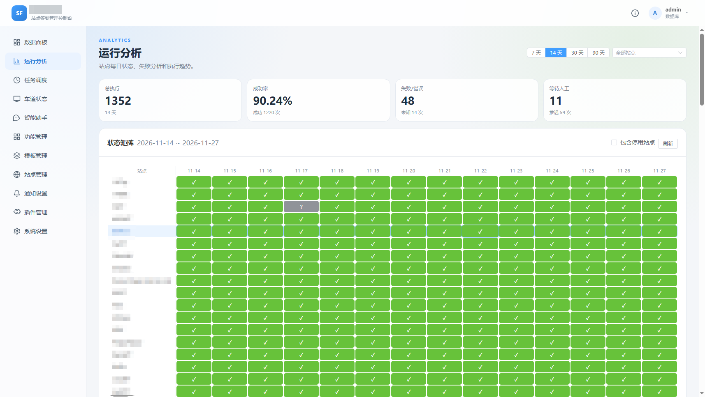
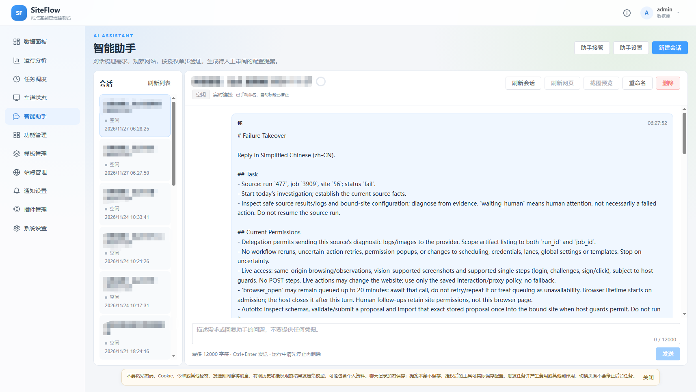
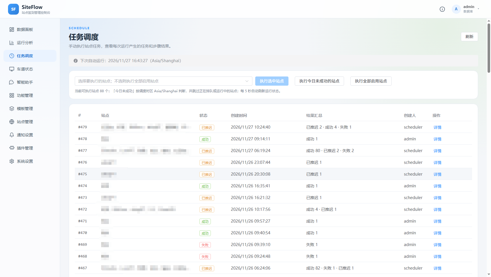
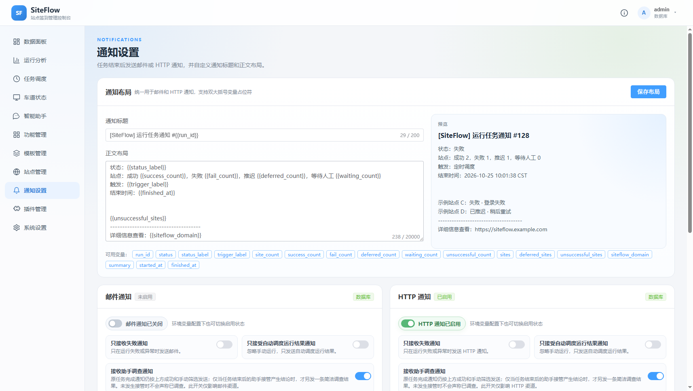
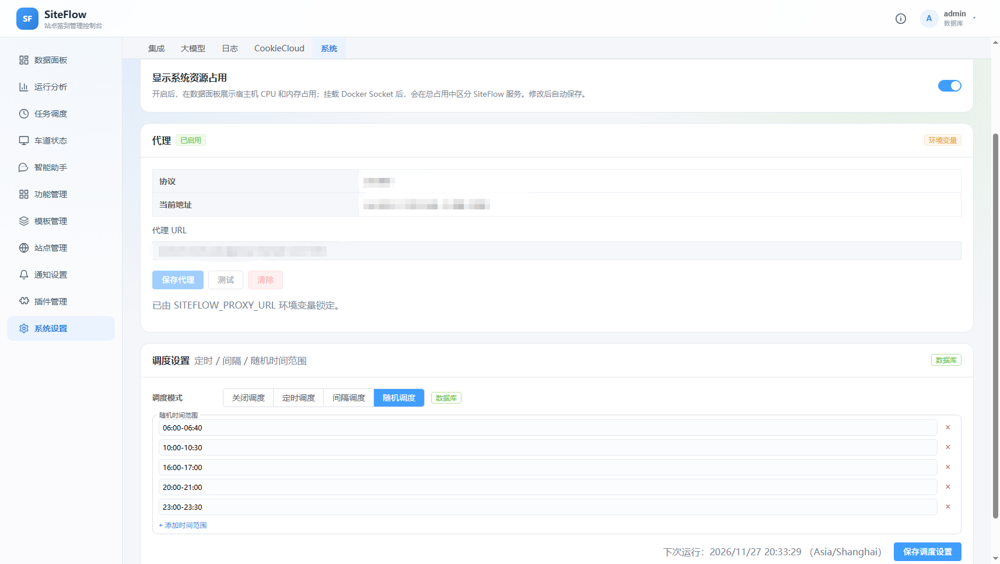

# SiteFlow

SiteFlow 是一个站点自动化管理工具，当前主要用于 **PT 站点签到**。通过可编排的工作流，将登录、验证、签到和补签串联起来，支持定时执行、浏览器人工接管和运行结果追踪。

支持的主要功能：

- **站点与工作流**：模板继承、站点覆盖、配置版本历史与恢复、条件判断、步骤跳转、配置导入导出及元素拾取；模板编辑器可从站点导入本地流程与父模板，仅填表、不自动保存。
- **登录与验证**：账户、Cookie、Bitwarden 和插件凭据；2FAuth；Turnstile、ALTCHA、图形验证码及视觉模型。
- **多模型配置**：整行「大模型」设置卡片，按优先级管理最多 20 条数据库连接（含旧配置条目），另可加 1 条环境变量连接，合计最多 21 条，也允许空列表；分别指定功能卡片/助手用途及视觉能力，无主次模型之分。已有 20 条数据库连接时，环境变量条目仍完整显示，不截断、丢弃或因此禁用列表操作；请求前选择合格模型，请求失败不自动换模型，MCP 用途仅预留。
- **签到与补签**：按钮操作、iframe 签到、UNIT3D Claim、NexusPHP 日历补签、页面循环补签（`post.resign_loop`）、弹窗按钮补签和补签卡购买。
- **自动执行**：手动运行、定时/间隔/随机调度、并发限制、取消与超时处理。
- **浏览器管理**：普通/代理、通用/交互四条车道，按需启动、空闲关闭，以及 noVNC 实时查看和人工操作。
- **智能助手**：可选启用的加密持久化对话、自动标题、脱敏查询、受限观察与真实单步验证，普通交互 38 个工具，另有 1 个接管专用结论工具；23 项内置功能可编写提案及授权完整运行，18 项支持孤立单步，购买/补签仅在完整运行中逐次消费审核，插件不开放。支持绑定站点 Cookie 私有注入与人工审核清除、审核后保存站点流程为模板、全局调度变更、精确任务取消和历史版本/日志/图像读取；独立失败接管默认关闭，可仅分析或在当前失败快照仍匹配时只修工作流，另经 live_access 明确保存授权可无人值守浏览和真实单步，绝不自动完整重跑。「仅分析」不保存配置，不代表网站无副作用。提案本身不保存、不运行，新建站点默认禁用调度，不保证生产适用或业务成功。AI 辅助配置统一使用「智能助手」，站点页不再有独立生成入口。
- **结果与通知**：步骤进度、日志、失败截图、运行分析，以及邮件和 HTTP 通知（助手调查的 HTTP 通知可附带失败截图）。
- **插件扩展**：功能、验证码方法、凭据和 2FA 提供商接入，支持能力审批、停用和审计。

详细操作见 [使用指南](docs/usage.md)。验证码识别和浏览器自动化不能保证适用于所有站点，请仅用于你有权访问的账户和服务。

## 界面预览

点击图片可查看原图。截图中的站点信息和敏感配置已做遮挡。

| 数据面板 | 运行分析 · 状态概览 |
| --- | --- |
| [](docs/screenshots/dashboard.png) | [](docs/screenshots/analytics-overview.png) |

| 智能助手 | 任务调度 |
| --- | --- |
| [](docs/screenshots/assistant.png) | [](docs/screenshots/runs.png) |

| 车道状态 | 功能管理 |
| --- | --- |
| [](docs/screenshots/lanes.png) | [](docs/screenshots/features.png) |

| 模板管理 | 站点管理 |
| --- | --- |
| [](docs/screenshots/templates.png) | [](docs/screenshots/sites.png) |

| 通知设置 | 插件管理 |
| --- | --- |
| [](docs/screenshots/notifications.png) | [](docs/screenshots/plugins.png) |

| 系统设置 · 集成 | 系统设置 · 系统 |
| --- | --- |
| [](docs/screenshots/settings-integrations.png) | [](docs/screenshots/settings-system.png) |

## 快速开始

使用仓库根目录的 `docker-compose.yml` 部署。只需 Docker 和 Docker Compose；服务镜像从 GHCR 拉取，无需在服务器安装 Node.js 或构建工具。浏览器默认使用官方 CloakBrowser Manager 的 keyless 镜像及其自带的 Chromium `146.0.7680.177.5`，无需设置 `CLOAKBROWSER_LICENSE_KEY`。`SITEFLOW_BROWSER_TOKEN` 用于保护内部 Manager 接口，仍需生成并填写。

```bash
git clone https://github.com/hyuan280/SiteFlow.git
cd SiteFlow
cp .env.example .env
chmod 600 .env

# 分别生成加密主密钥与浏览器后端访问令牌
openssl rand -base64 32
openssl rand -hex 32
```

将生成结果分别填入 `.env` 的 `SITEFLOW_MASTER_KEY` 和 `SITEFLOW_BROWSER_TOKEN`，不要使用示例中的 `CHANGE_ME`。按需设置各组件的镜像版本，再启动：

```bash
docker compose pull
docker compose up -d
docker compose ps
```

打开 **http://localhost:8088**。修改访问端口可在 `.env` 设置 `SITEFLOW_WEB_PORT`。

首次部署前需确保所选版本已发布；私有 GHCR 镜像需要先登录。镜像版本、数据备份及 HTTPS 部署见 [部署与运维](docs/deployment.md) 和 [镜像发布](docs/releases.md)。

如需使用要求许可证的新版 CloakBrowser Manager，见[使用其他 Manager 镜像](docs/deployment.md#使用其他-manager-镜像)。并发 profile 预算与 Worker 重建命令见[有限容量与调度预检](docs/deployment.md#有限容量与调度预检)。

可选的 [Docker Socket 系统资源监控](docs/system-resources.md) 需单独启用，主 Compose 默认不挂载 socket；启用前请阅读权限风险说明。

### 首次登录

未设置 `SITEFLOW_ADMIN_PASSWORD` 且尚未保存管理员密码时，API 每次启动会生成随机的 `admin` 密码。通过日志查看：

```bash
docker compose logs api
```

登录后通过右上角账户菜单修改密码；保存后，后续启动不再生成随机密码。

也可在 `.env` 中指定管理员账户：

```dotenv
SITEFLOW_ADMIN_USERNAME=admin
SITEFLOW_ADMIN_PASSWORD=<自行设置的强密码>
```

环境变量中的管理员凭据优先使用，且不能在页面修改。

### 配置与安全

| 环境变量 | 是否必填 | 说明 |
| --- | --- | --- |
| `SITEFLOW_MASTER_KEY` | 是 | API 加密主密钥，填入以 Base64 编码的 32 字节随机密钥。 |
| `SITEFLOW_BROWSER_TOKEN` | 是（默认 Compose 部署） | Worker 与浏览器后端共享的访问令牌，使用独立的随机值。 |
| `SITEFLOW_COOKIE_SECURE` | 按条件 | 通过 HTTPS 访问时设为 `true`；本地 HTTP 保持默认 `false`。 |
| `SITEFLOW_WEB_PORT` | 否 | 根目录 Compose 对外发布的 Web 端口，默认 `8088`。 |
| `CLOAKBROWSER_LICENSE_KEY` | 按条件 | 默认 keyless 镜像无需许可证；选用要求许可证的镜像时，须通过此变量或 Manager 配置有效密钥。 |

- 代理、凭据和大模型等可在「系统设置」按需配置。完整变量、默认值与必填条件见[环境变量](docs/configuration-security.md#环境变量)，部署模板见 [`.env.example`](.env.example)。
- `.env` 不提交到 Git，权限设为 `600`；单独备份 `SITEFLOW_MASTER_KEY`。仅对外发布 Web 端口，使用 HTTPS 时设置 `SITEFLOW_COOKIE_SECURE=true`。
- 模型配置与升级、智能助手授权、失败接管和通知规则见[配置与安全](docs/configuration-security.md)。

## 开发和贡献

欢迎提交问题、使用反馈和 Pull Request。报告问题时请附上版本、相关步骤、预期结果及脱敏日志，不要附带真实凭据或未经处理的站点导出数据。

修改前可先阅读 [架构](docs/architecture.md)。提交功能或修复时，请补充对应测试和使用说明；浏览器相关改动优先在隔离 Demo 中验证，不使用正式站点执行购买、补签等有副作用的操作。

### 规划

以下为可能继续完善的方向，不代表已实现功能或交付承诺：

- 适配更多浏览器后端，以及不依赖共享 X11 的桌面操作方式。
- 更细的插件配置兼容性提示、变更历史和审计关联。
- 加强浏览器与插件故障诊断、隔离回归和运行可观测性。
- 按实际需求评估多 Worker、多 API 和共享授权存储。

当前以单机部署和 SQLite 为主，不提供历史开发版本数据库迁移、自动站点禁用或自动根因判断。

### 目录结构

```text
backend/               API、认证、站点配置、调度、运行记录与测试
worker/                工作流执行、浏览器后端适配、插件 broker
frontend/              Vue 3 管理界面与 noVNC
plugins/               插件运行时及可导入的 Demo
proto/                 插件 gRPC 协议与生成代码
ops/                   Dockerfile、源码部署 Compose、构建脚本
scripts/               协议代码生成等开发工具
docs/                  使用、配置、部署及开发文档
.github/workflows/     组件镜像发布工作流
docker-compose.yml     GHCR 镜像部署入口
```

### 本地构建与镜像发布

从源码本地构建时，使用 `ops/build.sh` 构建应用镜像，再通过 `ops/docker-compose.yml` 启动。浏览器仍默认使用同一官方 keyless 镜像。本地构建另需 Node.js 22+/npm，先按快速开始准备根目录的 `.env`：

```bash
bash ops/build.sh
docker compose -f ops/docker-compose.yml up -d
```

构建网络需要使用 host 时，运行 `bash ops/build.sh --host`。这只改变构建网络，不改变容器运行网络。根目录和 `ops/` Compose 使用相同项目名及数据卷，不要当作两个独立实例同时启动。

GitHub Actions 按组件标签独立发布，例如：

```bash
git tag api-v1.0
git push origin api-v1.0
```

上述标签仅发布 `ghcr.io/hyuan280/siteflow-api:v1.0` 和对应 `latest`；另外支持 `worker-v*`、`web-v*`、`bitwarden-v*`。预发布版本不更新 `latest`，推送 `main` 不会自动发布镜像。细节见 [镜像发布](docs/releases.md)。

### 常用命令

部署命令在项目根目录执行：

```bash
docker compose logs -f api worker browser  # 查看日志
docker compose ps                        # 查看服务状态
docker compose pull                      # 拉取发布镜像
docker compose up -d                      # 启动或应用更新
docker compose down                      # 停止，保留数据卷
```

开发检查使用项目虚拟环境及前端依赖：

```bash
.venv/bin/pytest -q backend/tests
.venv/bin/pytest -q plugins/runtime/tests
npm --prefix frontend run type-check
npm --prefix frontend run build
git diff --check
```

依赖准备见 [后端开发](backend/README.md)，隔离浏览器与故障测试见 [验证说明](docs/verification.md)。

### API

交互式 API 文档：**http://localhost:8088/api/docs**。

常用入口包括 `/api/v1/sites`、`/api/v1/templates`、`/api/v1/features` 和 `/api/v1/runs`。管理接口通常需要登录会话，修改请求还需 `X-CSRF-Token`；不要将内部 Worker 或插件控制接口直接暴露到公网。接口列表见 [后端说明](backend/README.md)。

## 文档

- [使用指南](docs/usage.md)：配置站点、编排流程、执行与排查。
- [CookieCloud](docs/cookiecloud.md)：只读服务配置、PyCookieCloud 接入与 Cookie 域名排查。
- [配置历史](docs/workflow-history.md)：版本快照、依赖追溯、恢复与并发保护。
- [草稿校验](docs/workflow-drafts.md)：未保存配置的校验、继承解析与无写入预览接口。
- [智能助手](docs/ai-assistant.md)：38 个普通交互工具及 1 个接管专用工具、持久化聊天、绑定站点 Cookie 私有注入/审核清除、授权观察/验证/导入、站点转模板、全局调度/取消、历史资料及失败接管边界。
- [外部 Agent / MCP 授权设计](docs/assistant-agent-mcp-authorization.md)：独立审批、异步恢复和策略预授权的后续方案，尚未实现。
- [NexusPHP 示例](docs/examples/nexusphp-assistant-workflow.json)：源模板只读脱敏改编、默认禁用且不含购买/补签；配合[证据发现指南](docs/assistant-discovery.md)，不是在线实测或通用适配保证。
- [AI 配置协议](docs/config-ai.md)：功能生成说明、受控目录、编排指南与工具定义。
- [部署与运维](docs/deployment.md)：Docker 部署、端口、数据与备份。
- [系统资源监控](docs/system-resources.md)：可选 Docker Socket 部署、host 统计口径与安全边界。
- [集成配置](docs/configuration.md)：代理、凭据提供商、CFbox 和多模型配置。
- [配置与安全](docs/configuration-security.md)：部署安全、模型升级、助手授权与失败接管。
- [模型与功能设置](docs/vision-feature-settings.md)：有序注册表 API、旧配置兼容/环境变量条目只读、用途与视觉选择、保存冲突、历史密钥脱敏及功能执行路由。
- [通知设置](docs/notifications.md)：邮件、HTTP 图文通知与内容模板。
- [运行通知](docs/run-notifications.md)：即时任务通知、本地规划/去重、独立助手调查通知、逐通道开关与独立持久账本的最多一次发送边界。
- [管理员认证](docs/authentication.md)：首次登录、会话与安全设置。
- [车道与 noVNC](docs/vnc.md)：浏览器控制与人工操作。
- [镜像发布](docs/releases.md)：GHCR、版本标签和权限。
- [浏览器后端](docs/browser-backends.md)：远程后端配置与适配边界。
- [架构](docs/architecture.md)、[功能块模型](docs/feature-model.md)、[数据模型](docs/data-model.md)：开发参考。
- [任务执行](docs/execution.md)、[运行分析](docs/analytics.md)：执行行为与结果查询。
- [插件系统](docs/plugin-system.md)、[插件 Demo](plugins/examples/demo/README.md)：扩展接入与示例。
- [验证说明](docs/verification.md)、[故障回归](plugins/examples/demo/FAULTS.md)：自动化测试。

## License

SiteFlow 原始代码使用 [MIT License](LICENSE)。第三方依赖、官方浏览器镜像、二进制及字体仍适用各自许可，MIT 不授予它们的再分发权；详见 [第三方说明](THIRD_PARTY_NOTICES.md)。
